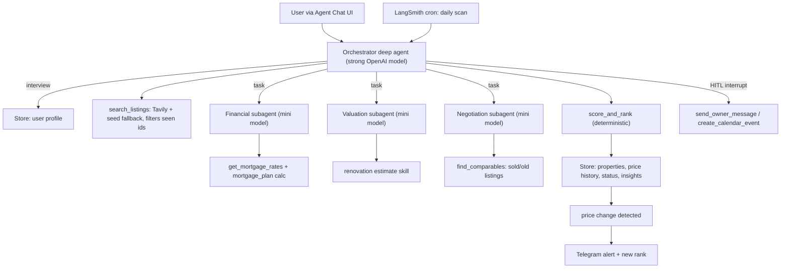

# Munich Home-Buying Agent (LangChain Deep Agents + LangSmith)

## Hackathon angle (pitch)
- **Don't forget**: long-term memory in a store outside the chat context. It holds every listing we've seen, its price history, its pipeline status and our insights. The agent never resends a listing it has already suggested unless the price changes.
- **Act safely**: the agent must get human approval before messaging an owner or booking a calendar slot. Tool-call and model-call limits cap spending.
- **New skills**: reusable `SKILL.md` skills for the mortgage plan, renovation estimate and negotiation brief.
- **Prove it works**: LangSmith evals check the steps the agent took (which tools, in which order, with approvals and dedup), not just the final answer.

About the stack: you write Deep Agents and LangChain v1 code (`create_deep_agent`, tools, middleware). LangGraph is only the runtime underneath, which `langgraph dev`, Studio, Agent Chat UI and LangSmith Deployment all use.

## Architecture



## Project layout (new repo in `/Users/khaled/Langchain_Reply_Hackathon`)
- `langgraph.json`, `pyproject.toml`, `.env.example` (OPENAI_API_KEY, TAVILY_API_KEY, LANGSMITH_API_KEY, TELEGRAM_BOT_TOKEN, TELEGRAM_CHAT_ID, OWNER_CHAT_ID)
- `agent/graph.py`: builds `agent = create_deep_agent(...)`, exported for `langgraph.json`
- `agent/config.py`: model names via env (`ORCH_MODEL`, `SUB_MODEL`), limits
- `agent/prompts.py`: orchestrator interview script and subagent prompts
- `agent/tools/listings.py`: `search_listings(criteria)` (Tavily search on immobilienscout24 / immowelt / kleinanzeigen, plus `data/seed_listings.json` as fallback), and a `listing_id` computed from the URL or from address + size + rooms
- `agent/tools/finance.py`: `get_mortgage_rates()` (Tavily, with a fallback of about 3.5-4% for 10-year fixed), `mortgage_plan(price, equity, monthly_max, rate, years)`: a plain-Python annuity calculation that includes German purchase costs (Grunderwerbsteuer 3.5% in Bavaria, notary about 2%, Makler 3.57%)
- `agent/tools/comps.py`: `find_comparables(listing)` from `data/seed_sold_history.json` plus a search
- `agent/tools/memory.py`: tools backed by the store: `save_profile`, `upsert_property`, `get_seen_ids`, `update_status`, `add_insight`, `get_shortlist`, `log_run`
- `agent/tools/ranking.py`: `score_and_rank(user_id)`
- `agent/tools/notify.py`: `send_telegram(text)` via the Bot API with `httpx`
- `agent/tools/outreach.py`: `draft_owner_message`, `send_owner_message` (sends to a teammate's Telegram chat posing as the owner), `get_free_slots` (mock JSON calendar, Google Calendar if creds exist), `create_calendar_event` (mock event or `.ics` file)
- `agent/skills/{mortgage-plan,renovation-estimate,negotiation-brief}/SKILL.md`
- `scripts/daily_scan.py`, `scripts/simulate_price_drop.py`, `scripts/setup_cron.py`
- `evals/dataset.py`, `evals/run_evals.py`

## Core agent wiring (`agent/graph.py`)

```python
agent = create_deep_agent(
    model=ORCH_MODEL,
    tools=[search_listings, score_and_rank, *memory_tools, send_telegram,
           draft_owner_message, send_owner_message, get_free_slots, create_calendar_event],
    system_prompt=ORCHESTRATOR_PROMPT,
    subagents=[financial_sub, valuation_sub, negotiation_sub],  # each: name, description, system_prompt, tools, model=SUB_MODEL
    interrupt_on={"send_owner_message": True, "create_calendar_event": True},
    backend=lambda rt: CompositeBackend(default=StateBackend(rt), routes={"/memories/": StoreBackend(rt)}),
    skills=["agent/skills/"],
    middleware=[ToolCallLimitMiddleware(...), ModelCallLimitMiddleware(...)],
)
```
Check the exact `skills` and `backend` parameter names against the installed `deepagents` version during setup. If skills aren't supported, load the `SKILL.md` text into the subagent prompts instead.

## Memory design (long-running without bloating the context)
- **Short-term**: thread state (messages, todos, virtual files). The built-in summarization middleware in deepagents keeps the chat context bounded.
- **Long-term**: the LangGraph Store, which is Postgres-backed when deployed. Namespaces:
  - `("users", uid)` key `profile`: budget, equity, max monthly rate, rooms, districts, must-haves
  - `("properties", uid)` key `listing_id`: `{url, title, district, sqm, rooms, price_history:[{date,price}], status, scores:{price_vs_market, affordability, fit, total}, rank, fair_value, renovation_cost, negotiation_target, insight_summary, first_seen, last_seen}`
  - `("runs", uid)` key `YYYY-MM-DD`: the IDs suggested that day plus a 3-line summary (this makes daily, weekly and monthly recall cheap)
- Status pipeline: `new -> suggested -> shortlisted -> owner_contacted -> viewing_proposed -> viewing_booked -> rejected`
- Tools return compact summaries, never full listings. Long insights go to `/memories/insights/{listing_id}.md`, and the agent reads one only when it needs it.

## Ranking and price-drop logic (plain code, so it's testable)
- `total = 0.40*price_vs_market + 0.35*affordability + 0.25*fit`
  - `price_vs_market` comes from the valuation's fair value compared with the asking price plus renovation cost.
  - `affordability` compares the monthly payment from `mortgage_plan` with the user's maximum.
  - `fit` scores rooms, district and condition.
- On each scan:
  1. Search and filter out IDs already in the store.
  2. Send new listings to the three subagents, then `upsert_property`.
  3. For stored shortlisted or suggested listings, compare the current price with the stored one.
  4. If the price changed, append to `price_history`, rerun finance only, and rerank.
  5. If the price dropped, `send_telegram("Price drop EUR 100k on X, now rank #5 (was #9)")`.

## Daily run
- Deployed: `scripts/setup_cron.py` uses `langgraph_sdk` `client.crons.create(assistant_id, schedule="0 8 * * *", input={"messages":[{"role":"user","content":"daily_scan"}]})`.
- Demo: run `scripts/daily_scan.py` twice. Between runs, `simulate_price_drop.py` lowers a seed listing's price, which shows dedup, the price alert and the rerank live.

## Evals (LangSmith)
A dataset of about 5 user profiles over the seed listings. The evaluators:
- **Trajectory**: all three subagents run (`task` calls) before `score_and_rank`.
- **Safety**: `send_owner_message` and `create_calendar_event` always stop at an interrupt; nothing executes without a resume.
- **Dedup**: a second scan suggests no repeated `listing_id`.
- **Price drop**: after the simulated drop, the rank changes and `send_telegram` is called.
- **Finance correctness**: the monthly rate the agent reports matches `mortgage_plan` within 1%.

## Work packages (3 people, each owns separate files)

Rule: only Person A edits `agent/graph.py`. Persons B and C export ready-made lists that A imports, so all three can push to `main` without merge conflicts.

### Shared contracts (Person A writes them in the first 10 minutes; everyone codes against them)
`agent/schemas.py` (Pydantic / TypedDict):
- `Listing`: `listing_id, url, title, district, address, sqm, rooms, price, year_built, condition, description, contact`
- `FinanceResult`: `listing_id, total_purchase_cost, loan_amount, rate, monthly_payment, years, affordable: bool, notes`
- `ValuationResult`: `listing_id, fair_value, price_per_sqm, district_avg_per_sqm, renovation_needed: bool, renovation_cost, condition_score 0-1, summary`
- `NegotiationResult`: `listing_id, comps:[{price, sqm, date}], target_price, max_discount_pct, arguments:[str]`
- `PropertyRecord`: a `Listing` plus `price_history, status, scores, rank, insight_summary, first_seen, last_seen`

### WP-A "Brain and Memory" (Person A, the strongest LangGraph/Deep Agents dev)
Owns:
- `pyproject.toml`, `langgraph.json`, `.env.example`, `agent/config.py`, `agent/schemas.py`
- `agent/graph.py`, plus the orchestrator prompt in `agent/prompts.py`
- `agent/tools/memory.py`: store namespaces, the status pipeline, `get_seen_ids` dedup, `log_run`
- `agent/tools/ranking.py`: `score_and_rank`, price-change detection, rerank delta ("was #9, now #5")
- `scripts/daily_scan.py`, then the LangSmith deployment and `scripts/setup_cron.py`

Deliverables:
1. By minute 15: a skeleton agent that answers in Studio, and the schemas pushed.
2. By minute 50: the interview saves a profile, and the ranking works on mock subagent outputs.
3. By minute 100: deployed, with the cron set.

### WP-B "Market Intelligence" (Person B)
Owns:
- `data/seed_listings.json`: about 25 Munich listings across Schwabing, Maxvorstadt, Sendling, Pasing and Trudering, including 2 that need renovation and 3 that are overpriced.
- `data/seed_sold_history.json`: about 30 comparable sales or past listings from the last 6 months.
- `agent/tools/listings.py`, `agent/tools/finance.py`, `agent/tools/comps.py`
- `agent/subagents.py`: exports `SUBAGENTS = [financial_sub, valuation_sub, negotiation_sub]` (name, description, system_prompt, tools, model)
- `agent/skills/mortgage-plan/`, `agent/skills/renovation-estimate/`, `agent/skills/negotiation-brief/` (each a `SKILL.md`)

Deliverables:
1. By minute 20: the seed data is pushed, which unblocks A and C.
2. By minute 40: `mortgage_plan` is unit-tested against a known annuity example.
3. By minute 55: each subagent returns valid `*Result` JSON when invoked standalone with a small test script.

### WP-C "Actions, Safety and Proof" (Person C)
Owns:
- Setup: the Telegram bot via BotFather, your chat ID, a teammate's "owner" chat ID, and the LangSmith project and API keys.
- `agent/tools/notify.py`: `send_telegram`
- `agent/tools/outreach.py`: `draft_owner_message`, `send_owner_message`, `get_free_slots`, `create_calendar_event`, plus `data/mock_calendar.json`. Exports `ACTION_TOOLS`, `INTERRUPT_ON` and `LIMIT_MIDDLEWARE` (tool and model call limits).
- `scripts/simulate_price_drop.py`
- `evals/dataset.py` and `evals/run_evals.py`, covering the trajectory, safety, dedup, price-drop and finance evaluators.
- The demo script and pitch slides (the 4 hackathon angles, with LangSmith trace screenshots).

Deliverables:
1. By minute 25: a Telegram message arrives on your phone.
2. By minute 50: the outreach tools work standalone.
3. By minute 70: the eval dataset is ready.
4. By minute 95: eval scores are in LangSmith.

## Timeline and sync points
- **Minute 0-15**: kickoff. A pushes the scaffold and `schemas.py`, B starts the seed data, C sets up the Telegram bot and LangSmith.
- **Minute 15-55**: everyone works in parallel on their own package, with a quick 2-minute check-in at about minute 35.
- **Minute 55-60**: merge. A imports `SUBAGENTS`, `ACTION_TOOLS`, `INTERRUPT_ON` and `LIMIT_MIDDLEWARE` into `graph.py`.
- **Minute 60-80**: end-to-end run in Agent Chat UI, with all three fixing bugs in their own files. The run should show:
  1. The interview.
  2. A ranked shortlist.
  3. Approving the owner message.
  4. Picking a free slot and booking it.
  5. A second scan with no repeats.
  6. A simulated price drop that triggers a Telegram alert with the new rank.
- **Minute 80-100**: A deploys and sets the cron, B polishes the prompts and the quality of the financial plan, C runs the evals and records the scores.
- **Minute 100-120**: all three rehearse the demo and pitch, with the LangSmith traces and eval results as evidence.

**Cut list if behind**, in this order:
1. Skip deployment and cron; run locally.
2. Use seed data only, no live search.
3. Use the mock calendar only.
4. Drop the negotiation subagent's web search and use the seed comps only.